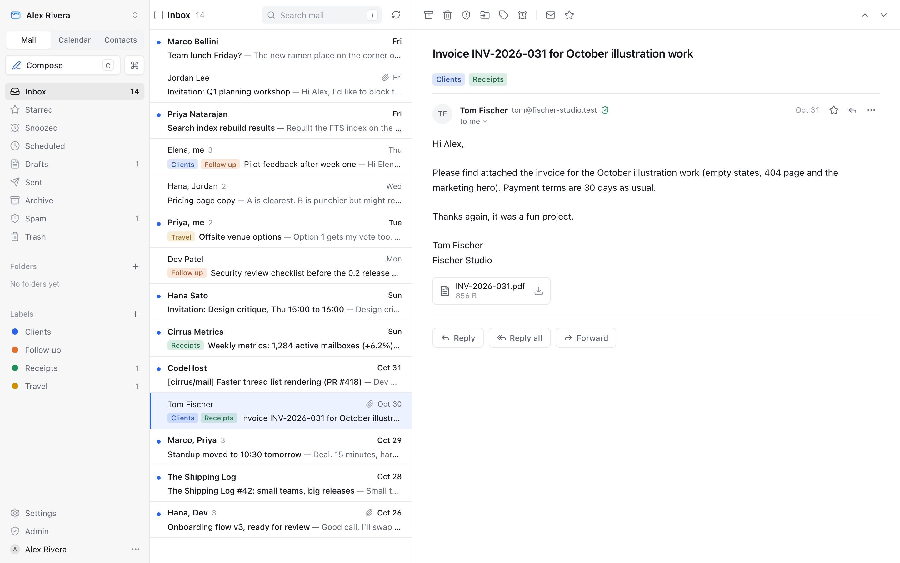
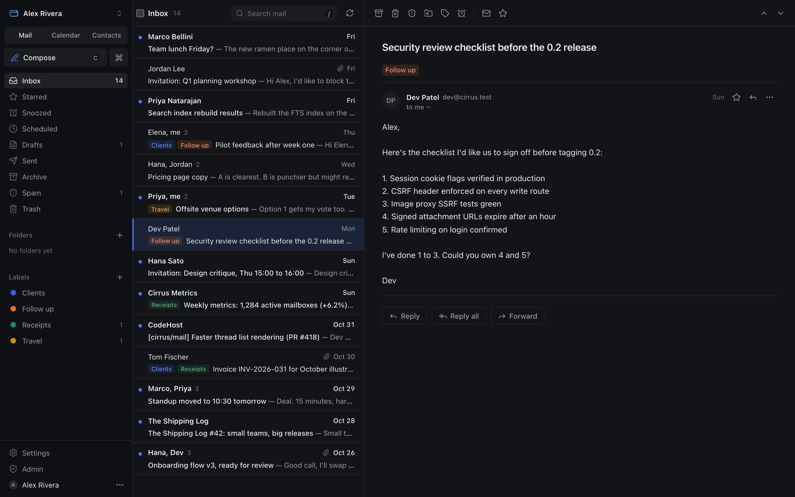
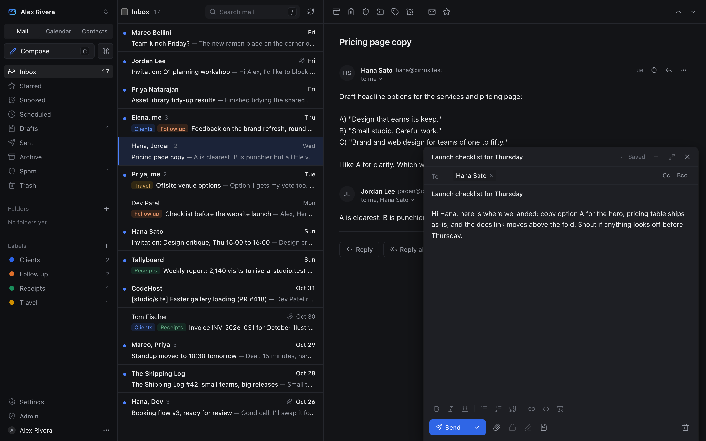
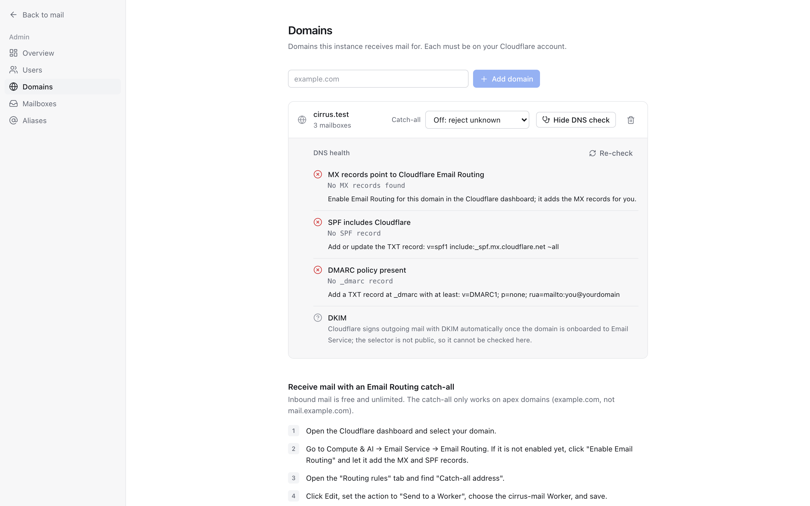
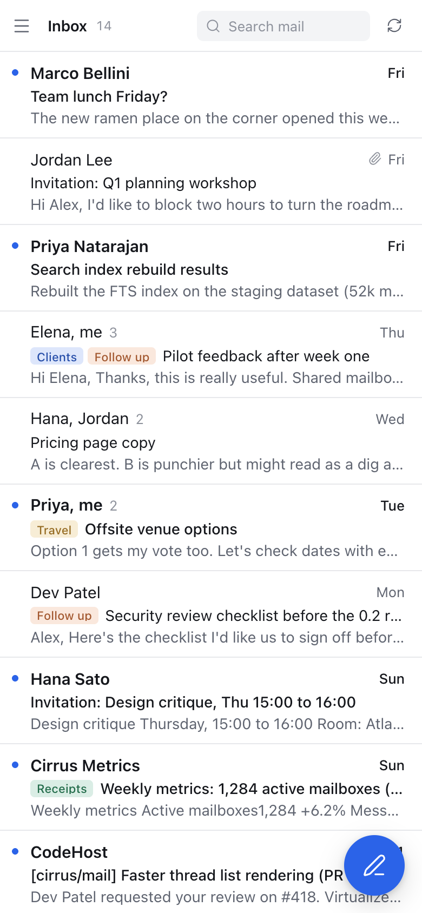
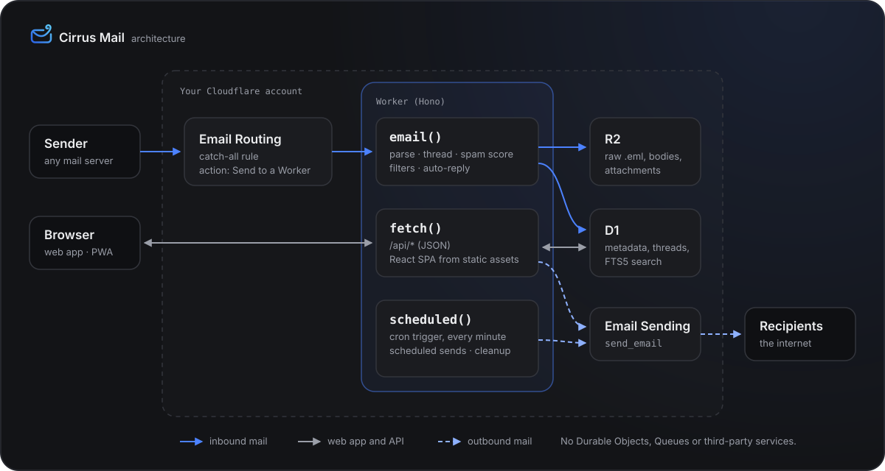

<p align="center">
  
</p>

<p align="center">
  <a href="LICENSE"></a>
  <a href="https://deploy.workers.cloudflare.com/?url=https://github.com/jackh54/cirrus-mail"></a>
  
  <a href="CONTRIBUTING.md"></a>
</p>

**Cirrus Mail** is an open-source email suite that runs entirely on your own Cloudflare account. Email Routing receives your mail, Email Sending sends it, D1 and R2 store it, and a single Worker serves a fast web client and the API. You get real mailboxes on your own domains for yourself, your family or a small team, with threading, search, folders, attachments, shared mailboxes and an admin console. There's no server to run and no third-party service, and nobody else holds your mail. If you have Workers Paid, you can deploy it in minutes.

<p align="center">
  <a href="https://deploy.workers.cloudflare.com/?url=https://github.com/jackh54/cirrus-mail"></a>
</p>

<p align="center">
  <a href="docs/setup.md"><b>Setup guide</b></a> ·
  <a href="docs/faq.md"><b>FAQ</b></a> ·
  <a href="docs/development.md"><b>Development</b></a> ·
  <a href="docs/design.md"><b>Design spec</b></a>
</p>

## Screenshots

<table>
  <tr>
    <td width="50%"></td>
    <td width="50%"></td>
  </tr>
  <tr>
    <td></td>
    <td></td>
  </tr>
  <tr>
    <td colspan="2" align="center"></td>
  </tr>
</table>

## Features

**Mail**
- Full mailboxes on your own domains, with conversation threading
- Inbox, Sent, Drafts, Archive, Spam, Trash and Scheduled, plus your own folders
- Labels: colour-coded tags, so one conversation can sit under several
- Snooze and mute conversations, and unsubscribe from newsletters in one click
- Optional inbox tabs and conversation summaries with Workers AI (off by default)
- Attachments up to 25 MiB per message, with inline images
- New-mail polling, an unread count in the tab title, browser notifications and Web Push
- Installable PWA that works on phones, with light, dark and system themes

**Compose**
- Rich text: bold, italic, underline, lists, quotes, links and code
- To/Cc/Bcc chips with contact autocomplete
- Send from your mailbox address or any of its aliases
- Drafts autosave as you type
- Send later, and undo send
- Reply templates
- Optional end-to-end PGP: encrypt, sign and verify in the browser
- Keyboard shortcuts for everything (`c`, `/`, `j`/`k`, `e`, `r`, `a`, `f`, `?`)

**Search & organise**
- Full-text search (D1 FTS5) with `from:`, `to:`, `subject:`, `has:attachment`, `is:unread` and `is:starred`
- Filters that move, mark read, star, label, delete or forward
- Search by label with `label:name`
- Per-mailbox blocked senders
- Built-in spam scoring based on SPF, DKIM and DMARC results
- Vacation auto-reply with loop protection

**Security & privacy**
- PBKDF2 password hashing and optional TOTP 2FA with recovery codes
- Passkeys for passwordless sign-in, or as a second factor
- App passwords for sync clients, so your account password never leaves the web app
- HTML mail sanitized and rendered in a sandboxed frame with no scripts
- Remote images blocked by default, and proxied when you allow them
- Signed, short-lived attachment URLs
- No invocation logs, and message content is never logged

**Calendar, contacts and apps**
- Calendar and Contacts pages in the web app, with invite cards in the reader (accept, maybe or decline)
- CalDAV and CardDAV sync for Apple and Android devices, with a downloadable Apple `.mobileconfig`
- A JMAP server, so JMAP-capable mail apps can connect to your mailboxes
- mbox import (for example from Gmail through Google Takeout) and mbox export
- A native iOS app, in public beta on [TestFlight](#ios-app-beta)

**Admin**
- Users, domains, mailboxes, aliases and catch-all addresses
- Email invites: add someone's sign-in email and Cirrus sends them a link to set up their account
- Shared mailboxes with several members
- A DNS health check for MX, SPF and DMARC
- Instance stats: storage, and mail sent and received
- An AI switch and daily budget for the optional Workers AI features

**Self-hosting**
- One Worker, one D1 database, one R2 bucket
- No Durable Objects, no Queues, no third-party services
- One-click deploy, or `npm run deploy` from the CLI
- Upgrade with `git pull && npm run deploy`

## iOS app (beta)

A native iPhone app for Cirrus is in public beta. It needs iOS 26 or later.

**[Join the TestFlight beta](https://testflight.apple.com/join/u5zScSGa)**

1. Install [TestFlight](https://apps.apple.com/app/testflight/id899247664) from the App Store, then open the link above on your iPhone.
2. In the Cirrus web app, go to **Settings → Security → App passwords** and create one for your phone.
3. Open the app and enter your Cirrus server address, your sign-in email and the app password. Use the app password, not your account password.

The app talks to your server over JMAP, so it works with any Cirrus instance that runs this release or later. It's an early beta: reading, searching, organising and sending work; attachments in compose and notifications aren't in yet.

## How it works

<p align="center">
  
</p>

- **Inbound:** Email Routing's catch-all rule hands each message to the Worker's `email()` handler. Cirrus finds the mailbox, parses the message, threads it, scores it for spam, runs your filters, then stores the raw `.eml` and attachments in R2 and the metadata and search index in D1.
- **App and API:** the same Worker's `fetch()` handler serves the React web client from static assets and a JSON API under `/api/*`.
- **Outbound:** sending calls the `send_email` binding, which hands the message to Cloudflare Email Sending.
- **Cron:** `scheduled()` runs every minute. It sends scheduled messages and cleans up old Trash and Spam.

## What it costs

Cirrus is free. You pay Cloudflare for your own usage:

| | |
|---|---|
| **Workers Paid** | $5/month, which includes **3,000 outbound emails/month**, then **$0.35 per 1,000** |
| **Inbound mail** (Email Routing) | Free |
| **D1 + R2** | Usage-based; a typical small team stays within the included tiers |

Prices change, so check Cloudflare's pricing page before you rely on these numbers.

## Limits

- **50 recipients** per message (To + Cc + Bcc)
- **25 MiB** per message, attachments included
- A **daily send quota** that starts conservative and grows over time
- **Email Sending is in beta**, so expect changes
- No IMAP, because Workers can't accept inbound TCP connections. Mail apps connect over JMAP instead ([roadmap](#roadmap))

> [!IMPORTANT]
> **Acceptable use.** Cloudflare documents Email Sending as being for **transactional email**. Its documentation doesn't explicitly address person-to-person mail sent from your own mailbox, which is what Cirrus does. Cirrus has no bulk, mailing-list or marketing features, and never will. Review Cloudflare's terms for your use before you rely on it.

## Quick start

1. Make sure you have **Workers Paid** and a domain on **Cloudflare DNS**.
2. Onboard the domain to **Email Sending** (Compute & AI → Email Service) and enable **Email Routing**.
3. Click **Deploy to Cloudflare** above, or run:
   ```sh
   git clone https://github.com/jackh54/cirrus-mail.git && cd cirrus-mail
   npm ci && npx wrangler login
   npx wrangler secret put SETUP_TOKEN
   npx wrangler secret put APP_SECRET
   npm run deploy
   ```
4. Open `/setup`, create your admin account, and add your domain and mailboxes in Admin.
5. Point the domain's Email Routing **catch-all** rule at the `cirrus-mail` Worker.

The **[setup guide](docs/setup.md)** walks through every step, plus custom domains, backups and troubleshooting.

## Security model

- **Passwords:** PBKDF2-SHA256 (100,000 iterations) with a per-user salt, compared in constant time.
- **Sessions:** random tokens stored only as SHA-256 hashes, in `HttpOnly; Secure; SameSite=Lax` cookies. Every state-changing API call also needs a custom header (CSRF protection).
- **2FA:** optional TOTP with hashed one-time recovery codes. Failed logins are throttled.
- **HTML mail:** sanitized with DOMPurify and rendered in a sandboxed `<iframe>`, with no scripts, no same-origin access and a strict CSP.
- **Remote images:** blocked by default. When you load them, they go through an HMAC-signed image proxy, so senders can't track you and the proxy isn't open to anyone else.
- **Attachments:** served from signed URLs that expire after an hour.
- **Logs:** Worker invocation logs are off, and Cirrus never logs message content.

Found a vulnerability? Please report it privately; see [SECURITY.md](SECURITY.md).

## Roadmap

Still open:

- **Native mobile apps.** The iOS app is in [TestFlight beta](#ios-app-beta); push notifications and attachments in compose are next. Android isn't started.
- **IMAP.** Cloudflare Workers can't accept inbound TCP connections, so Cirrus can't run an IMAP server. Mail apps connect over JMAP instead. An optional IMAP bridge that you run somewhere else may come later.
- **PGP extras:** publishing your own key over WKD, key expiry and subkey management, and changing a key's passphrase.
- **Calendar scheduling:** free/busy, calendar sharing and iTIP over CalDAV.
- **More JMAP:** push subscriptions, delayed sending and mailbox hierarchy.

## Contributing

Contributions are welcome: bug reports, fixes, docs and features. Read [CONTRIBUTING.md](CONTRIBUTING.md) to get set up, and [docs/development.md](docs/development.md) for local development. Everyone taking part follows the [Code of Conduct](CODE_OF_CONDUCT.md).

## License

[MIT](LICENSE) © 2026 Jack Harris (PandaScript)

Cirrus Mail is an independent project, not affiliated with or endorsed by Cloudflare.

---

<p align="center">
  <br>
  <sub>Built by <b>PandaScript</b></sub>
</p>
